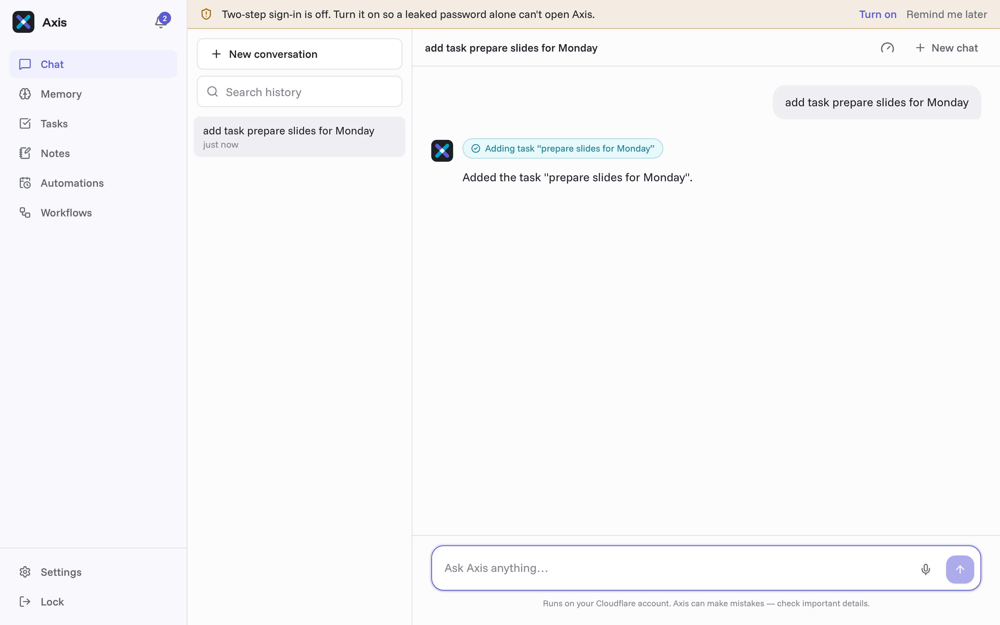
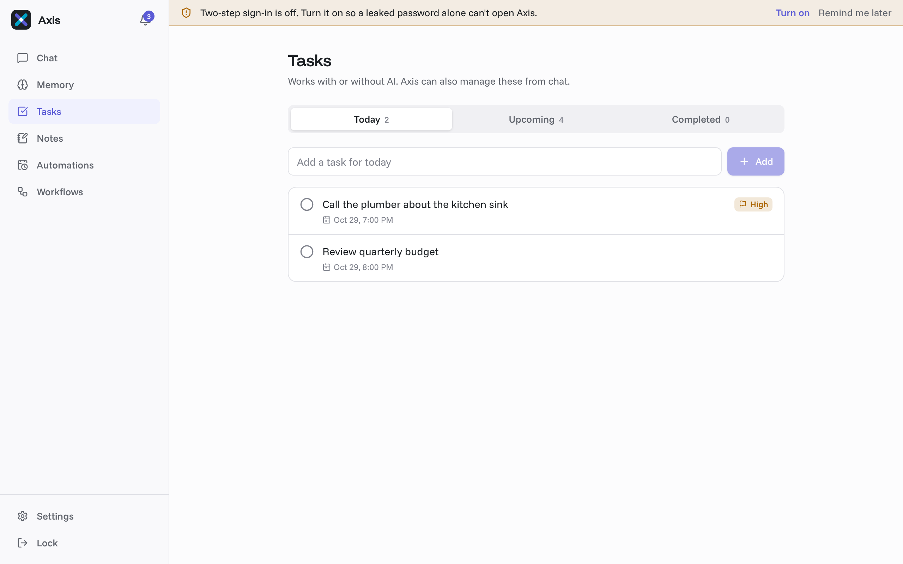
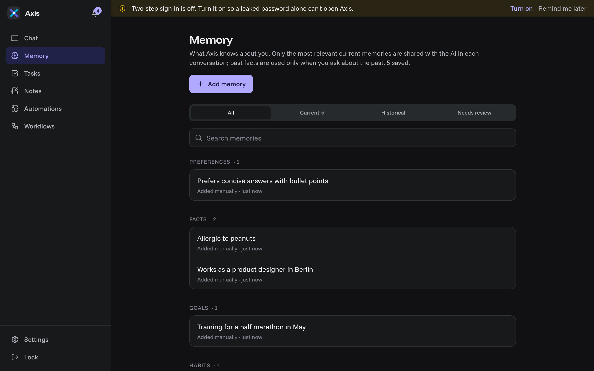
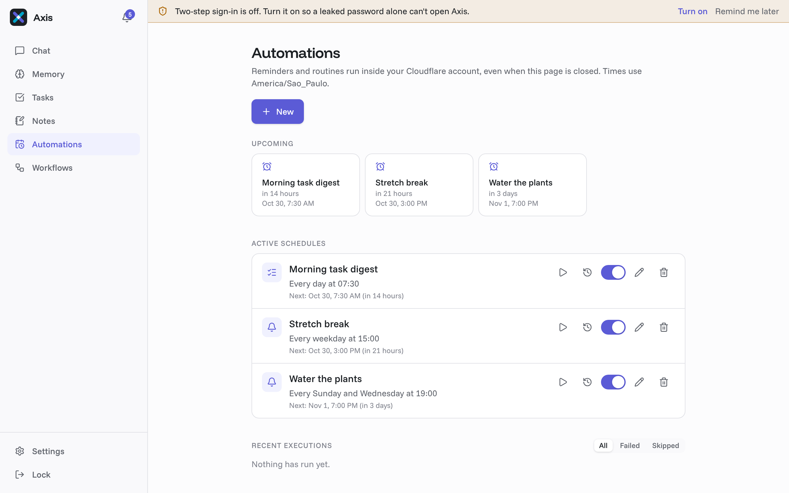
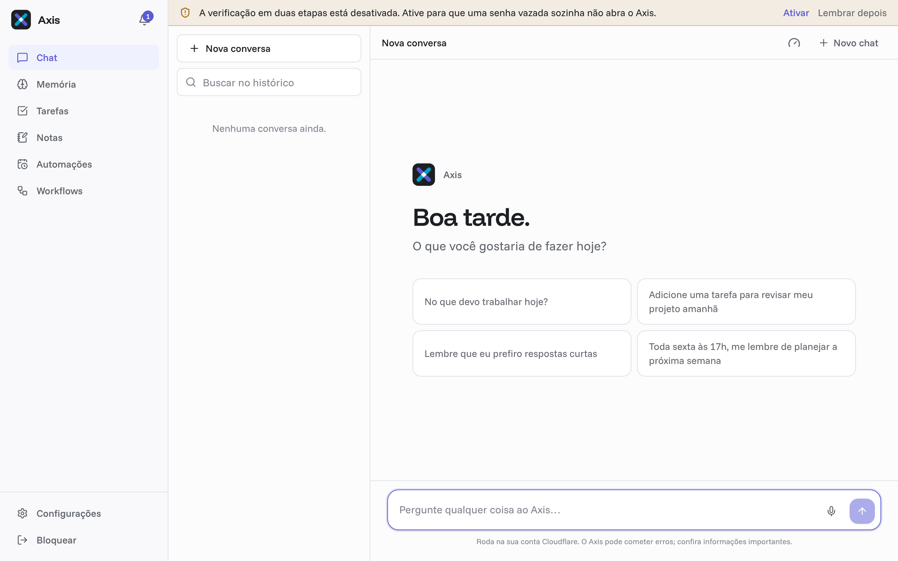
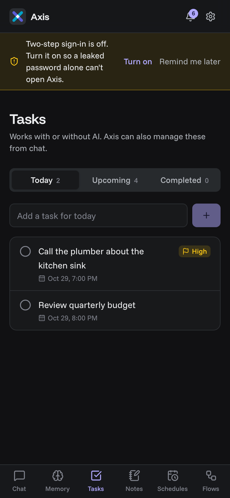
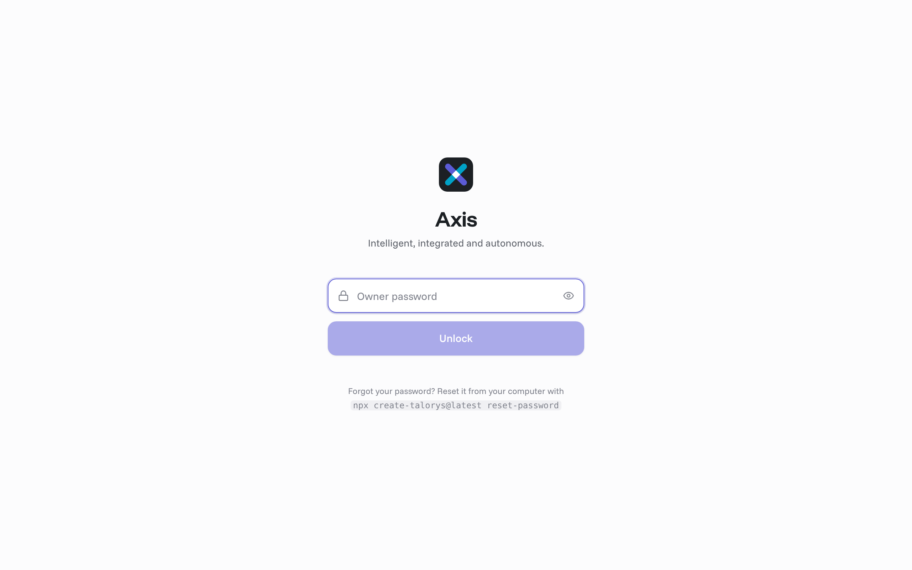
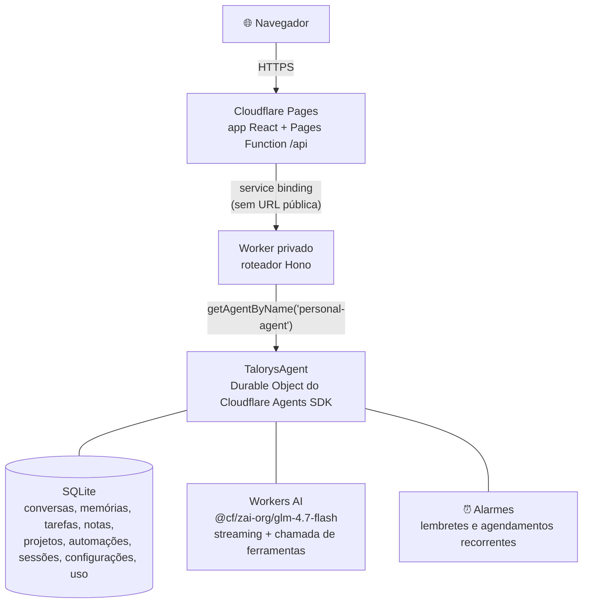

<div align="center">


# Talorys

**Seu agente pessoal de IA. Na sua própria nuvem.**

Um assistente pessoal de IA gratuito e de código aberto que roda inteiramente dentro da **sua própria conta Cloudflare**.<br>
Nenhum servidor, banco de dados ou conta operados pelos desenvolvedores do Talorys.

[](LICENSE)
[](https://developers.cloudflare.com/workers/)
[](https://nodejs.org)
[](#-o-que-é-gratuito-e-o-que-pode-custar-dinheiro)
[](#-onde-ficam-seus-dados)

[Implantação](#-implantação) · [Documentação](docs/) · [Segurança](docs/security.md) · [Como contribuir](CONTRIBUTING.md) · [Changelog](CHANGELOG.md)

</div>

---

<div align="center">

**Uma pessoa. Uma conta Cloudflare. Um comando. Um agente pessoal de IA.**

```bash
npx create-talorys@latest
```

Ou instale com o [Appflare](https://appflare.dev), que o implanta como um [único Worker](docs/deployment.md#um-worker-sem-pages):

[](https://appflare.dev/install/talorys/)

</div>

---

## Sumário

- [✨ Funcionalidades](#-funcionalidades)
- [📸 Capturas de tela](#-capturas-de-tela)
- [🧭 Como funciona](#-como-funciona)
- [☁️ Serviços da Cloudflare utilizados](#️-serviços-da-cloudflare-utilizados)
- [🚀 Implantação](#-implantação)
- [🔑 Acesso](#-acesso)
- [🔒 Onde ficam seus dados](#-onde-ficam-seus-dados)
- [💸 O que é gratuito e o que pode custar dinheiro](#-o-que-é-gratuito-e-o-que-pode-custar-dinheiro)
- [💾 Backup dos seus dados](#-backup-dos-seus-dados)
- [🔄 Atualização](#-atualização)
- [🩺 Solução de problemas](#-solução-de-problemas)
- [🛠️ Desenvolvimento local](#️-desenvolvimento-local)
- [📁 Estrutura do repositório](#-estrutura-do-repositório)
- [🙌 Créditos](#-créditos)
- [📄 Licença](#-licença)

---

## ✨ Funcionalidades

### Assistente

| | Funcionalidade | O que faz |
| :---: | --- | --- |
| 💬 | **Chat privado** | Respostas em streaming, Markdown e indicadores da atividade das ferramentas. |
| 🎙️ | **Entrada por voz** | Toque no microfone, fale (até 1 minuto) e o Whisper do Workers AI transcreve na sua conta; o texto cai na caixa para você revisar antes de enviar. O áudio não é guardado e há um teto próprio de 60 minutos de áudio por dia. |
| 🧠 | **Memória** | Fatos e preferências pessoais duradouros, que você pode ver, editar e apagar. Só as memórias mais relevantes são enviadas ao modelo a cada mensagem. |
| 🔎 | **Busca semântica** <sub>opcional</sub> | Encontra memórias pelo significado, além das palavras-chave, lista as mais recentes primeiro com a data em que foram salvas e permite que o agente encontre tarefas, notas e automações pelo significado. [Saiba mais](docs/semantic-recall.md) |
| 🕰️ | **Histórico da memória** | Fatos que mudam com o tempo: quando você diz que vendeu o carro, o Talorys pergunta se o antigo agora é um fato passado. Com a verificação opcional por IA, uma resposta confiante já resolve por você; conflitos pouco claros aguardam sua revisão. [Saiba mais](docs/memory-history.md) |

### Produtividade

| | Funcionalidade | O que faz |
| :---: | --- | --- |
| ✅ | **Tarefas, notas e projetos** | Criar, ver, editar e apagar pela interface e pelo chat (_"Adicione uma tarefa para revisar meu projeto amanhã"_). Prazos de tarefas criados pelo chat recusam datas impossíveis no calendário, inclusive horários com fuso UTC explícito. |
| 🗺️ | **Planejamento de tarefas com IA** | Descreva um objetivo (_"Planeje as tarefas para lançar meu app de iOS no mês que vem"_) e receba um plano em um cartão interativo. Revise, edite ou remova tarefas, escolha um projeto e confirme: nada é criado antes disso, e a confirmação cria tudo de uma vez, uma única vez. |
| ⏰ | **Automações** | Lembretes únicos e recorrentes, resumos diários de tarefas e rotinas de IA opcionais, entregues numa central de notificações dentro do app. Rodam com alarmes de Durable Objects, então nada precisa ficar online. |
| 🔁 | **Workflows** | Rotinas que antes ficavam no n8n, executadas pelos Workflows da Cloudflare com novas tentativas automáticas: monitor de sites (avisa quando um site cai e quando volta). Cada uma tem uma chave liga/desliga no menu **Workflows**. Plano gratuito. Veja [docs/workflows.md](docs/workflows.md). |
| 🔔 | **Notificações push** | Lembretes, resumos e rotinas chegam como notificações do sistema nos aparelhos em que você ativar, mesmo com o Talorys fechado (**Configurações → Avisos**). Usa Web Push padrão, com criptografia de ponta a ponta. |
| 📣 | **Central de avisos** | Todo aviso tem prioridade (baixa, normal, alta ou crítica, editável em cada notificação) e categoria. Você escolhe quais categorias saem do app, limita quantas mensagens cada canal manda por hora e por dia e vê o histórico de entregas com o motivo de cada aviso não enviado. Avisos repetidos são descartados. Avisos de prioridade alta insistem (de novo em 15 min e em 1 h) até você tocar em Feito, Adiar ou Silenciar. A prioridade aprende com o seu uso (correções, rapidez, avisos ignorados), no máximo um nível por semana, e você fixa ou zera cada tipo de aviso. Vigias a cada 15 min avisam de prazos, rotinas falhando, MCP sem login, orçamento de IA e backup antigo, e o resumo do dia chega às 07:30. Mudanças de segurança (senha, token, acesso remoto, Telegram, backup) avisam por todos os canais, inclusive e-mail pelo Cloudflare Email Routing, mesmo para quem entrou no app. [Saiba mais](docs/alerts.md) |
| ✈️ | **Avisos no Telegram** | Um bot do Telegram registra os avisos num grupo (com um tópico por categoria, se o grupo tiver tópicos) ou no chat privado. Discreto por padrão, com texto completo por categoria, e botões para marcar como feito ou adiar 1 hora. No chat privado, você conversa com o Talorys como no app, por texto ou mensagem de voz (até 5 minutos). Só a sua conta é ouvida. [Saiba mais](docs/alerts.md#telegram) |

> [!TIP]
> No iPhone e no iPad, adicione o Talorys à Tela de Início antes de ativar as notificações push.

### Integrações e design

| | Funcionalidade | O que faz |
| :---: | --- | --- |
| 🔌 | **Servidores MCP remotos** <sub>opcional</sub> | Conecte servidores [MCP](https://modelcontextprotocol.io) remotos em **Configurações → Integrações** (sem autenticação, com token bearer ou login OAuth) e escolha quais ferramentas deles o Talorys pode usar. As ferramentas começam desligadas, e chamadas que podem alterar algo aguardam sua aprovação. As que rodam sem perguntar também podem ser liberadas para as rotinas agendadas. [Saiba mais](docs/mcp.md) |
| 👤 | **Usuário único por design** | Sem cadastro, sem contas, sem equipes. O instalador define a senha do dono. |
| 🛟 | **Funciona sem IA** | Tarefas, notas, memórias e lembretes continuam funcionando se o Workers AI estiver indisponível ou se a sua cota gratuita acabar. |

> [!NOTE]
> A busca semântica vem desligada. Ative-a com o botão **Busca semântica de memórias**, perto do fim de **Configurações → IA** (as outras opções aparecem depois que ele é ligado), ou instale com `--semantic`.

---

## 📸 Capturas de tela

<table>
  <tr>
    <th>Chat com atividade das ferramentas</th>
    <th>Tarefas</th>
  </tr>
  <tr>
    <td></td>
    <td></td>
  </tr>
  <tr>
    <th>Memória (modo escuro)</th>
    <th>Automações</th>
  </tr>
  <tr>
    <td></td>
    <td></td>
  </tr>
  <tr>
    <th colspan="2">Entrada por voz: toque no microfone, fale e revise o texto antes de enviar</th>
  </tr>
  <tr>
    <td colspan="2"></td>
  </tr>
</table>

<p align="center">
  
  &nbsp;
  
</p>

---

## 🧭 Como funciona



- O navegador só conversa com o seu site `*.pages.dev`. As requisições `/api/*` executam uma Pages Function que as repassa, por um **service binding**, ao Worker do agente.
- O Worker do agente é implantado com `workers_dev: false` e `preview_urls: false`: ele **não tem URL pública**.
- A autenticação e a autorização acontecem no Worker, não no frontend.
- As respostas do chat chegam em streaming como Server-Sent Events, de ponta a ponta.

Mais detalhes: [docs/architecture.md](docs/architecture.md).

---

## ☁️ Serviços da Cloudflare utilizados

| Serviço | Usado para | Plano Free |
| --- | --- | :---: |
| Cloudflare Pages | Frontend + Pages Function | ✅ |
| Cloudflare Workers | Worker privado da API | ✅ |
| Durable Objects (SQLite) | Todos os dados e os alarmes de agendamento | ✅ |
| Workers AI | Modelo do chat (`@cf/zai-org/glm-4.7-flash`) | ✅ cota diária |

O Talorys **não** provisiona R2, D1, KV, Vectorize, AI Search, Workflows nem qualquer serviço pago.

---

## 🚀 Implantação

> [!IMPORTANT]
> **Guia completo de instalação na Cloudflare, passo a passo:** [docs/instalacao-cloudflare.md](docs/instalacao-cloudflare.md). Ele cobre conta, domínio, HTTPS, token, GitHub (regras, ambientes, Actions, secret scanning, CodeQL), primeiro deploy, segredos, Access, Turnstile, e-mail, push, Telegram, n8n, MCP, Google Agenda, Workflows e a primeira release.

```bash
npx create-talorys@latest
```

<details open>
<summary><strong>O que o instalador faz</strong></summary>

1. Verifica o Node.js (22+) e usa o Wrangler CLI que vem junto (um `wrangler`/`cf` instalado globalmente é detectado, mas não é necessário).
2. Confere o seu login na Cloudflare ou **abre a página de autorização da Cloudflare no navegador**.
3. Deixa você escolher a conta (se tiver mais de uma) e o nome do agente.
4. Pede a senha do dono (digitação oculta, com verificação de força). Ela é transformada em hash localmente com PBKDF2-SHA256 e guardada apenas como um secret da Cloudflare.
5. Gera um segredo de sessão de 256 bits, um par de chaves Web Push e nomes de recursos únicos (`talorys-<id>-agent`, `talorys-<id>-web`).
6. Implanta o Worker privado (criando o Durable Object com SQLite), guarda os secrets, cria e implanta o projeto do Pages com o service binding.
7. Verifica a implantação no ar (frontend, endpoint de autenticação, recusa de acesso sem login, saúde do armazenamento) **sem** rodar nenhuma inferência de IA.
8. Mostra a URL real `https://….pages.dev` informada pela Cloudflare.

</details>

Ele cria um diretório `talorys/` com o `talorys.json` (id da instalação, id da conta, nomes dos recursos, URL — **sem segredos**) e os artefatos de implantação. Guarde-o para as atualizações.

> [!TIP]
> **Foi interrompido?** Rode o mesmo comando de novo, no mesmo lugar. Ele reconcilia o que já existe: sem recursos duplicados, sem pedir a senha de novo se ela já estiver configurada e **sem nunca apagar dados**.

<details>
<summary><strong>Instalação não interativa</strong></summary>

```bash
TALORYS_OWNER_PASSWORD=... npx create-talorys@latest --yes --account-id <id>
```

Defina `CLOUDFLARE_API_TOKEN` se você não estiver logado.

</details>

<details>
<summary><strong>Permissões do token de API</strong></summary>

O login pelo navegador usa o fluxo OAuth padrão do Wrangler — sem Global API Key. Se você usar um token de API, ele precisa de:

| Escopo | Permissão |
| --- | --- |
| Account › Workers Scripts | Edit |
| Account › Cloudflare Pages | Edit |
| Account › Workers AI | Read |
| Account › Account Settings | Read |
| User › User Details | Read _(opcional; mostra o seu e-mail)_ |

</details>

Veja [docs/deployment.md](docs/deployment.md).

---

## 🔑 Acesso

Abra a URL que o instalador mostrar, digite a senha do dono e comece a conversar. Entre por quantos aparelhos quiser — todos são o mesmo dono. Gerencie as sessões em **Configurações → Segurança**.

Esqueceu a senha? Com os avisos por e-mail configurados, use **Esqueceu a senha?** na tela de login: chega um link de uso único, válido por 30 minutos (com a verificação em duas etapas ligada, ele também pede o código). Sem e-mail, no seu diretório `talorys/`:

```bash
npx create-talorys@latest reset-password
```

Isso substitui o secret da senha e desconecta todos os aparelhos.

---

## 🔒 Onde ficam seus dados

Todos os dados ficam num único Durable Object com SQLite (`personal-agent`) **na sua conta Cloudflare**.

> [!IMPORTANT]
> O Talorys não tem código de telemetria, analytics, rastreamento ou publicidade e não envia nada aos seus desenvolvedores.

A Cloudflare processa seus dados para prestar os serviços dela — inclusive a inferência do Workers AI sobre as suas mensagens do chat e as memórias relevantes incluídas em cada prompt. Leia a política de privacidade da Cloudflare e os termos do Workers AI.

Se você conectar um servidor MCP remoto, chamar uma das ferramentas dele envia os argumentos dessa chamada ao servidor, fora da sua conta Cloudflare. Nada é enviado a um servidor MCP a menos que você o tenha conectado e ligado a ferramenta. Veja [docs/mcp.md](docs/mcp.md#privacidade).

| Leia mais | |
| --- | --- |
| 🛡️ Modelo de segurança e mitigação de ameaças | [docs/security.md](docs/security.md) |
| 🔐 Chamar a API por scripts com tokens de acesso pessoal | [docs/remote-access.md](docs/remote-access.md) |

---

## 💸 O que é gratuito e o que pode custar dinheiro

O Talorys foi feito para caber no **plano Free do Cloudflare Workers** e nunca ativa recursos pagos por conta própria. Mas não é "gratuito e ilimitado":

- Os planos Free têm cotas por conta (requisições, uso de Durable Objects e uma cota diária de Neurons do Workers AI). As cotas são definidas pela Cloudflare e podem mudar.
- Quando a cota de IA acaba, o chat mostra uma mensagem clara e volta a funcionar depois da renovação diária. Todo o resto continua funcionando, e os seus dados não são afetados.
- Se a sua conta estiver num plano pago, o uso além do incluído é cobrado pela Cloudflare conforme o seu plano.

<details>
<summary><strong>Limites de proteção embutidos</strong> (ajustáveis em Configurações → IA)</summary>

- Máximo de tokens de saída.
- Máximo de tokens de contexto (o histórico mais antigo é resumido).
- Máximo de chamadas de ferramentas e de etapas de raciocínio por requisição.
- Máximo de requisições de IA por dia (toda chamada ao modelo do chat conta, incluindo cada etapa de raciocínio, resumo do histórico e verificação de memória).
- Máximo de execuções agendadas de IA por dia.
- Os embeddings têm seu próprio limite diário de requisições.

Lembretes simples e resumos de tarefas nunca usam IA.

</details>

<details>
<summary><strong>Como o painel de uso estima o custo</strong></summary>

O painel de uso separa os **tokens informados pelo provedor** das **estimativas de tokens de reserva** e mostra, localmente, os Neurons estimados e o valor de inferência estimado em USD de hoje e dos últimos sete dias. As estimativas por modelo usam as tarifas estáticas publicadas do Workers AI no momento em que cada chamada é registrada; a data e a fonte dos preços aparecem como link no painel. Elas **não são uma fatura da Cloudflare nem o saldo da sua cota**: o uso de toda a conta e as franquias gratuitas ficam de fora. Essas estimativas não precisam de credenciais da conta nem de chamadas de rede extras.

Modelos sem suporte continuam sem preço, não gratuitos. Uma cobertura mista aparece como subtotal parcial, enquanto contagens históricas de tokens mistos mantêm o modelo e a origem como desconhecidos e não podem ser recalculadas. Chamadas de demonstração (mock) mostram tokens estimados, mas não têm consumo real de IA nem estimativa de Neurons ou USD. Etapas concluídas do modelo continuam contadas se uma etapa seguinte falhar ou for cancelada; etapas sem recibo de uso não podem ser medidas. Use o painel da Cloudflare, com link no app, para ver o uso e a cobrança de toda a conta.

</details>

---

## 💾 Backup dos seus dados

**Configurações → Privacidade → Baixar backup** gera o arquivo `talorys-backup.json` com conversas, memórias, tarefas, notas, projetos, configurações e automações (nunca sessões ou credenciais).

**Importar dados** valida o arquivo e o mescla numa única transação. Importar o mesmo backup duas vezes não causa problema, e uma memória, tarefa, nota ou projeto que você editou localmente depois do backup não é sobrescrito.

<details>
<summary><strong>Detalhes da importação</strong></summary>

- O histórico da memória (fatos atuais e passados) vai junto. Backups antigos são importados como antes.
- As configurações incluem os padrões efetivos do instalador.
- Se o fuso horário importado mudar, as automações locais mantidas também são reagendadas nesse fuso.

</details>

> [!WARNING]
> Um arquivo de backup é tratado como não confiável: automações novas chegam pausadas, automações existentes nunca são alteradas (no máximo, pausadas), e o modelo, os limites, o modo de demonstração, a memória automática e as configurações do histórico da memória são mantidos como estão (o resultado da importação lista o que foi ignorado).

---

## 🔄 Atualização

No seu diretório `talorys/`:

```bash
npx create-talorys@latest update
```

Isso reimplanta a versão mais recente do Worker e do frontend nos **mesmos** recursos. O namespace do Durable Object nunca é recriado (as migrações só acrescentam), a senha do dono e as sessões são mantidas, e as migrações de schema rodam automaticamente, em transação, na primeira requisição.

Também disponíveis: `status` e `doctor`.

---

## 🩺 Solução de problemas

| Problema | Solução |
| --- | --- |
| O instalador parou no meio | Rode o mesmo comando de novo; ele continua de onde parou. |
| "did not pass its health checks yet" | Sites `pages.dev` novos podem levar alguns minutos. Rode de novo. |
| Erros de permissão | Use uma conta em que você possa editar Workers e Pages, ou um token com as [permissões acima](#-implantação). |
| O chat diz que a cota de IA acabou | Espere a renovação diária, ou ative o **Modo demonstração** em **Configurações → IA**. |
| Bloqueado depois de logins com erro | Espere 15 minutos ou redefina a senha pela CLI. |

```bash
npx create-talorys@latest doctor   # verifica tudo automaticamente
```

Mais em [docs/troubleshooting.md](docs/troubleshooting.md).

---

## 🛠️ Desenvolvimento local

Requisito: **Node.js 24+** (recomendado: o LTS ativo, Node.js 26, fixado em `.nvmrc`; com nvm, rode `nvm use`).

```bash
git clone https://github.com/rociiu/talorys.git
cd talorys
npm install
npm run dev
```

`npm run dev` inicia tudo num único terminal:

| Processo | Porta |
| --- | --- |
| Worker do agente (`wrangler dev`) | 8787 |
| Proxy da Pages Function com o service binding (`wrangler pages dev`) | 8788 |
| Interface Vite | [localhost:5173](http://localhost:5173) |

Ele cria `apps/agent/.dev.vars` com uma senha local (`dev-Owner-violeta-trem-81`, que pode ser trocada com `TALORYS_DEV_PASSWORD`) e usa o provedor de IA simulado e determinístico, então não é preciso fazer login na Cloudflare. O estado fica salvo em `.wrangler/state`.

| Script | |
| --- | --- |
| `npm run build` | Compila todos os workspaces |
| `npm test` | Testes unitários |
| `npm run test:e2e` | Testes de interface com Playwright |
| `npm run test:pack` | Teste do pacote do instalador |
| `npm run typecheck` | Verificação de tipos do TypeScript |
| `npm run lint` | Lint com Biome |

Veja [docs/development.md](docs/development.md).

---

## 📁 Estrutura do repositório

```
apps/agent              Worker privado: API Hono, TalorysAgent, ferramentas, repositórios SQLite
apps/web                App React + Vite, Pages Function (functions/api/[[path]].ts)
packages/shared         Schemas Zod, tipos, lógica de recorrência/horário de verão, hash de senha
packages/create-talorys Instalador de um comando só (pacote npm)
tests/e2e               Testes de interface com Playwright
tests/smoke             Teste opcional de implantação numa conta real
docs/                   Arquitetura, implantação, desenvolvimento, segurança, solução de problemas
```

---

## 🙌 Créditos

Obrigado a todos que contribuíram com o Talorys:

| Contribuidor | Contribuição |
| --- | --- |
| [Roc Yu (@rociiu)](https://github.com/rociiu) | Criador e mantenedor |
| [Derek (@KrunchMuffin)](https://github.com/KrunchMuffin) | Exigência do Node.js 22, correções na exclusão de tarefas e em turnos cancelados, suporte a build no Windows |
| [Rudy Celekli (@rudycelekli)](https://github.com/rudycelekli) | Ciclo de vida das automações, verificação da implantação e correções nas configurações portáteis do backup |
| [Andrew B (@who)](https://github.com/who) | Busca semântica opcional para memórias |
| [Mendy Landa (@MendyLanda)](https://github.com/MendyLanda) | Implantação em um único Worker |
| [Michael Tuszynski (@michaeltuszynski)](https://github.com/michaeltuszynski) | Tratamento de importação de backup não confiável, contabilidade do orçamento diário de IA e aprovações vinculadas ao que foi mostrado |
| [김형준 (@wasuphj)](https://github.com/wasuphj) | Correções na política de senhas, nas datas de recorrência e na proteção de vetores |

---

## 📄 Licença

Distribuído sob a [Licença MIT](LICENSE).
