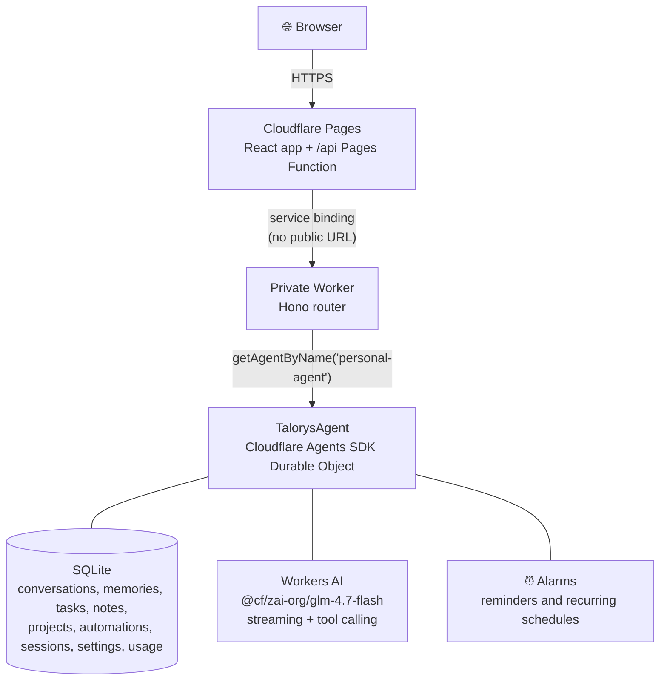

<div align="center">


# Talorys

**Your personal AI agent. Your own cloud.**

A free, open-source personal AI assistant that runs entirely inside **your own Cloudflare account**.<br>
No server, database or account operated by the Talorys developers.

[](LICENSE)
[](https://developers.cloudflare.com/workers/)
[](https://nodejs.org)
[](#-what-is-free-and-what-may-cost-money)
[](#-where-your-data-lives)

[Website](https://rociiu.github.io/talorys/) · [Deploy](#-deploy) · [Docs](docs/) · [Security](docs/security.md) · [Contributing](CONTRIBUTING.md) · [Changelog](CHANGELOG.md)

</div>

---

<div align="center">

**One person. One Cloudflare account. One command. One personal AI agent.**

```bash
npx create-talorys@latest
```

Or install it with [Appflare](https://appflare.dev), which deploys it as a [single Worker](docs/deployment.md#one-worker-without-pages):

[](https://appflare.dev/install/talorys/)

</div>

---

## Contents

- [✨ Features](#-features)
- [📸 Screenshots](#-screenshots)
- [🧭 How it works](#-how-it-works)
- [☁️ Cloudflare services used](#️-cloudflare-services-used)
- [🚀 Deploy](#-deploy)
- [🔑 Access](#-access)
- [🔒 Where your data lives](#-where-your-data-lives)
- [💸 What is free and what may cost money](#-what-is-free-and-what-may-cost-money)
- [💾 Back up your data](#-back-up-your-data)
- [🔄 Update](#-update)
- [🩺 Troubleshooting](#-troubleshooting)
- [🛠️ Local development](#️-local-development)
- [📁 Repository layout](#-repository-layout)
- [🙌 Credits](#-credits)
- [📄 License](#-license)

---

## ✨ Features

### Assistant

| | Feature | What it does |
| :---: | --- | --- |
| 💬 | **Private chat** | Streaming responses, Markdown and tool activity indicators. |
| 🧠 | **Memory** | Durable personal facts and preferences you can view, edit and delete. Only the most relevant memories are sent to the model on each turn. |
| 🔎 | **Semantic recall** <sub>optional</sub> | Finds memories by meaning as well as keyword, lists them newest first with their saved date, and lets the agent find tasks, notes and automations by meaning. [Learn more](docs/semantic-recall.md) |
| 🕰️ | **Memory history** | Facts that change over time: when you say you sold your car, Talorys asks whether the old one is now a past fact. With the optional AI check, a confident answer does it for you; unclear conflicts wait for your review. [Learn more](docs/memory-history.md) |

### Productivity

| | Feature | What it does |
| :---: | --- | --- |
| ✅ | **Tasks, notes and projects** | Full CRUD in the UI, and from chat (_"Add a task to review my project tomorrow"_). Chat task due dates reject impossible calendar dates, including timestamps with explicit UTC offsets. |
| 🗺️ | **AI task planning** | Describe a goal (_"Plan the tasks to launch my iOS app next month"_) and get a plan as an interactive card. Review, edit or remove tasks, pick a project, then confirm: nothing is created until you do, and confirming creates everything at once, exactly once. |
| ⏰ | **Automations** | One-time and recurring reminders, daily task digests and optional AI routines, delivered to an in-app notification center. They run on Durable Object alarms, so nothing has to stay online. |
| 🔔 | **Push notifications** | Reminders, digests and routines arrive as system notifications on the devices you turn them on for, even when Talorys is closed (**Settings → General**). Standard Web Push, encrypted end to end. |

> [!TIP]
> On iPhone and iPad, add Talorys to the Home Screen before turning on push notifications.

### Integrations and design

| | Feature | What it does |
| :---: | --- | --- |
| 🔌 | **Remote MCP servers** <sub>optional</sub> | Connect remote [MCP](https://modelcontextprotocol.io) servers in **Settings → Integrations** (no auth, a bearer token, or OAuth sign-in) and choose which of their tools Talorys may use. Tools start off, and calls that may change something wait for your approval. Not used by scheduled routines. [Learn more](docs/mcp.md) |
| 👤 | **Single-user by design** | No signup, no accounts, no teams. The installer sets the owner password. |
| 🛟 | **Works without AI** | Tasks, notes, memories and reminders keep working if Workers AI is unavailable or your free quota is used up. |

> [!NOTE]
> Semantic recall is off by default. Turn it on with the **Semantic memory recall** switch near the bottom of **Settings → AI** (its other settings appear once it is on), or install with `--semantic`.

---

## 📸 Screenshots

<table>
  <tr>
    <th>Chat with tool activity</th>
    <th>Tasks</th>
  </tr>
  <tr>
    <td></td>
    <td></td>
  </tr>
  <tr>
    <th>Memory (dark mode)</th>
    <th>Automations</th>
  </tr>
  <tr>
    <td></td>
    <td></td>
  </tr>
</table>

<p align="center">
  
  &nbsp;
  
</p>

---

## 🧭 How it works



- The browser only ever talks to your `*.pages.dev` site. `/api/*` requests run a Pages Function that forwards them over a **service binding** to the agent Worker.
- The agent Worker is deployed with `workers_dev: false` and `preview_urls: false`: it has **no public URL**.
- Authentication and authorization happen in the Worker, not the frontend.
- Chat responses stream as Server-Sent Events end-to-end.

More detail: [docs/architecture.md](docs/architecture.md).

---

## ☁️ Cloudflare services used

| Service | Used for | Free plan |
| --- | --- | :---: |
| Cloudflare Pages | Frontend + Pages Function | ✅ |
| Cloudflare Workers | Private API Worker | ✅ |
| Durable Objects (SQLite) | All data, scheduling alarms | ✅ |
| Workers AI | Chat model (`@cf/zai-org/glm-4.7-flash`) | ✅ daily allocation |

Talorys does **not** provision R2, D1, KV, Vectorize, AI Search, Workflows or any paid service.

---

## 🚀 Deploy

```bash
npx create-talorys@latest
```

<details open>
<summary><strong>What the installer does</strong></summary>

1. Checks Node.js (22+) and uses its bundled Wrangler CLI (any globally installed `wrangler`/`cf` is detected but not required).
2. Verifies your Cloudflare login, or **opens Cloudflare's authorization page in your browser**.
3. Lets you choose an account (if you have several) and an agent name.
4. Asks for an owner password (hidden input, strength-checked). It is hashed locally with PBKDF2-SHA256 and stored only as a Cloudflare secret.
5. Generates a 256-bit session secret, a Web Push key pair, and unique resource names (`talorys-<id>-agent`, `talorys-<id>-web`).
6. Deploys the private Worker (creating its SQLite Durable Object), stores secrets, creates and deploys the Pages project with the service binding.
7. Verifies the live deployment (frontend, auth endpoint, unauthenticated rejection, storage health) **without** running any AI inference.
8. Prints the real `https://….pages.dev` URL reported by Cloudflare.

</details>

It writes a `talorys/` directory containing `talorys.json` (installation id, account id, resource names, URL — **no secrets**) and the deployable artifacts. Keep it for updates.

> [!TIP]
> **Interrupted?** Run the same command again in the same place. It reconciles what already exists: no duplicate resources, no password re-prompt if the password is already configured, and **no data is ever deleted**.

<details>
<summary><strong>Non-interactive installs</strong></summary>

```bash
TALORYS_OWNER_PASSWORD=... npx create-talorys@latest --yes --account-id <id>
```

Set `CLOUDFLARE_API_TOKEN` if you are not logged in.

</details>

<details>
<summary><strong>API token permissions</strong></summary>

Browser login uses Wrangler's standard OAuth flow — no Global API Key. If you use an API token instead, it needs:

| Scope | Permission |
| --- | --- |
| Account › Workers Scripts | Edit |
| Account › Cloudflare Pages | Edit |
| Account › Workers AI | Read |
| Account › Account Settings | Read |
| User › User Details | Read _(optional; shows your email)_ |

</details>

See [docs/deployment.md](docs/deployment.md).

---

## 🔑 Access

Open the URL the installer prints, enter your owner password, and start chatting. Sign in from any number of devices — they are all the same owner. Manage sessions under **Settings → Security**.

Forgot the password? From your `talorys/` directory:

```bash
npx create-talorys@latest reset-password
```

This replaces the password secret and signs out every device.

---

## 🔒 Where your data lives

All data is stored in a single SQLite-backed Durable Object (`personal-agent`) **in your Cloudflare account**.

> [!IMPORTANT]
> Talorys has no telemetry, analytics, tracking or advertising code and sends nothing to its developers.

Cloudflare processes your data to provide its services — including running Workers AI inference on your chat messages and the relevant memories included in each prompt. Review Cloudflare's privacy policy and Workers AI terms.

If you connect a remote MCP server, calling one of its tools sends that call's arguments to the server, outside your Cloudflare account. Nothing is sent to an MCP server unless you connected it and turned the tool on. See [docs/mcp.md](docs/mcp.md#privacy).

| Read more | |
| --- | --- |
| 🛡️ Security model and threat mitigations | [docs/security.md](docs/security.md) |
| 🔐 Calling the API from scripts with personal access tokens | [docs/remote-access.md](docs/remote-access.md) |

---

## 💸 What is free and what may cost money

Talorys is designed to fit the **Cloudflare Workers Free plan** and never enables paid features on its own. It is not "unlimited free", though:

- Free plans have account-level quotas (requests, Durable Object usage, a daily Workers AI Neuron allocation). Quotas are set by Cloudflare and can change.
- When the AI allocation is exhausted, chat shows a clear message and resumes after the daily reset. Everything else keeps working, and your data is untouched.
- If your account is on a paid plan, usage beyond included amounts is billed by Cloudflare under your plan.

<details>
<summary><strong>Built-in guardrails</strong> (adjustable in Settings → AI)</summary>

- Max output tokens.
- Max context tokens (older history is summarized).
- Max tool calls and reasoning steps per request.
- Max AI requests per day (every chat-model call counts, including each reasoning step, history summary and memory check).
- Max scheduled AI runs per day.
- Embeddings have their own daily request cap.

Simple reminders and task digests never use AI.

</details>

<details>
<summary><strong>How the Usage panel estimates cost</strong></summary>

The Usage panel separates **provider-reported tokens** from **fallback token estimates**, and shows local estimated Neurons and USD inference value for today and the last seven days. Model-specific estimates use static published Workers AI rates at the time each call is recorded; the pricing date and source are linked in the panel. They are **not a Cloudflare bill or quota balance**: account-wide usage and free allowances are excluded. No account credentials or extra network calls are needed for these estimates.

Unsupported models remain unpriced, not free. Mixed coverage is labelled as a partial subtotal, while historical mixed token counts retain an unknown model and provenance and cannot be repriced. Demo/mock calls show estimated tokens but have no real AI consumption and no Neuron or USD estimate. Completed model steps remain counted if a later step fails or is cancelled; steps without a usage receipt cannot be measured. Use the linked Cloudflare dashboard for account-level usage and billing.

</details>

---

## 💾 Back up your data

**Settings → Privacy → Download backup** produces `talorys-backup.json` with conversations, memories, tasks, notes, projects, settings and automations (never sessions or credentials).

**Import** validates the file and merges it in one transaction. Importing the same backup twice is harmless, and a memory, task, note or project you edited locally after the backup was made is not overwritten.

<details>
<summary><strong>Import details</strong></summary>

- Memory history (current vs. past facts) is included. Older backups import as before.
- Settings include the effective installer defaults.
- If an imported timezone changes, retained local automations are also rescheduled in that timezone.

</details>

> [!WARNING]
> A backup file is treated as untrusted: new automations arrive paused, existing automations are never changed except to pause them, and the model, limits, demo mode, auto-memory and memory history settings are kept as they are (the import result lists any it skipped).

---

## 🔄 Update

From your `talorys/` directory:

```bash
npx create-talorys@latest update
```

This redeploys the latest Worker and frontend to the **same** resources. The Durable Object namespace is never recreated (migrations are append-only), the owner password and sessions are kept, and schema migrations run automatically and transactionally on first request.

Also available: `status` and `doctor`.

---

## 🩺 Troubleshooting

| Problem | Fix |
| --- | --- |
| Installer stopped midway | Re-run the same command; it resumes. |
| "did not pass its health checks yet" | New `pages.dev` sites can take a few minutes. Re-run. |
| Permission errors | Use an account where you can edit Workers and Pages, or a token with the [permissions above](#-deploy). |
| Chat says the AI allocation is used up | Wait for the daily reset; or enable Demo mode in **Settings → AI**. |
| Locked out after failed logins | Wait 15 minutes, or reset the password with the CLI. |

```bash
npx create-talorys@latest doctor   # checks everything automatically
```

More in [docs/troubleshooting.md](docs/troubleshooting.md).

---

## 🛠️ Local development

Requirements: **Node.js 22+**.

```bash
git clone https://github.com/rociiu/talorys.git
cd talorys
npm install
npm run dev
```

`npm run dev` starts everything in one terminal:

| Process | Port |
| --- | --- |
| Agent Worker (`wrangler dev`) | 8787 |
| Pages Function proxy with its service binding (`wrangler pages dev`) | 8788 |
| Vite UI | [localhost:5173](http://localhost:5173) |

It creates `apps/agent/.dev.vars` with a local password (`talorys-dev-password`, override with `TALORYS_DEV_PASSWORD`) and uses the deterministic mock AI provider, so no Cloudflare login is needed. State persists in `.wrangler/state`.

| Script | |
| --- | --- |
| `npm run build` | Build every workspace |
| `npm test` | Unit tests |
| `npm run test:e2e` | Playwright UI tests |
| `npm run test:pack` | Installer package test |
| `npm run typecheck` | TypeScript checks |
| `npm run lint` | Biome lint |

See [docs/development.md](docs/development.md).

---

## 📁 Repository layout

```
apps/agent              Private Worker: Hono API, TalorysAgent, tools, SQLite repositories
apps/web                React + Vite app, Pages Function (functions/api/[[path]].ts)
packages/shared         Zod schemas, types, recurrence/DST logic, password hashing
packages/create-talorys The one-command installer (npm package)
tests/e2e               Playwright UI tests
tests/smoke             Optional real-account deployment test
docs/                   Architecture, deployment, development, security, troubleshooting
```

---

## 🙌 Credits

Thanks to everyone who has contributed to Talorys:

| Contributor | Contribution |
| --- | --- |
| [Roc Yu (@rociiu)](https://github.com/rociiu) | Creator and maintainer |
| [Derek (@KrunchMuffin)](https://github.com/KrunchMuffin) | Node.js 22 requirement, task deletion and cancelled-turn fixes, Windows build support |
| [Rudy Celekli (@rudycelekli)](https://github.com/rudycelekli) | Automation lifecycle, deployment verification, and portable backup settings fixes |
| [Andrew B (@who)](https://github.com/who) | Opt-in semantic recall for memories |
| [Mendy Landa (@MendyLanda)](https://github.com/MendyLanda) | Single-Worker deployment |
| [Michael Tuszynski (@michaeltuszynski)](https://github.com/michaeltuszynski) | Untrusted backup import handling, daily AI budget accounting, and approvals bound to what was shown |
| [김형준 (@wasuphj)](https://github.com/wasuphj) | Password policy, recurrence date, and vector guard fixes |

---

## 📄 License

Released under the [MIT License](LICENSE).
